# 实现层数据库 Schema

> 本文档描述当前代码的实现层 Schema，是需求文档 11 张核心表的超集。它不替代 `需求文档.docx`，也不改变需求中的业务实体。

## 1. 与需求 11 张核心表的关系

| 需求逻辑表 | 当前物理表 | 说明 |
|---|---|---|
| user | `users` | 增加邮箱验证、登录锁定、手机号密文/盲索引、软删除、版本号 |
| product | `products` | `condition` 物理列名为 `condition_level`，API 继续返回 `condition` |
| category | `categories` | 保留品类表 |
| product_category | `product_categories` | 商品与品类多对多关联 |
| user_behavior | `user_behaviors` | 统一使用 `value`，增加 `metadata_json` |
| role | `roles` | RBAC 角色 |
| permission | `permissions` | RBAC 权限 |
| user_role | `user_roles` | 用户-角色关联 |
| role_permission | `role_permissions` | 角色-权限关联 |
| order | `orders` | 使用复数表名，避免 MySQL 保留字 `ORDER` |
| order_item | `order_items` | 订单明细 |

## 2. 生产支撑表

这些表是为了满足认证、会话、Agent、审计和交易流程而增加的生产支撑表：

| 表 | 作用 |
|---|---|
| `auth_sessions` | Refresh Token 会话、轮换、吊销、设备/IP/UA 记录 |
| `api_keys` | Agent 服务账号 API Key、scopes、过期与吊销 |
| `email_verification_tokens` | 邮箱验证一次性 token |
| `password_reset_tokens` | 密码重置一次性 token |
| `operation_logs` | 管理员与 Agent 操作审计，记录 actor、资源、before/after、trace_id |
| `carts` | 购物车 |
| `reviews` | 商品评价 |

其中购物车、评价来自 `新项目要求.md`；会话、API Key、验证 token、审计日志属于生产化支撑能力。

## 3. 关键字段差异

### users

- `email_normalized`：统一小写，唯一索引
- `phone_ciphertext` / `phone_hash`：手机号密文与盲索引，接口只返回脱敏值
- `email_verified_at`：邮箱验证时间
- `password_changed_at`：密码修改时间
- `failed_login_count` / `locked_until`：登录失败锁定
- `is_active`：封禁状态
- `deleted_at`：软删除
- `version`：并发更新版本号

### products

- 物理列：`condition_level`
- API 字段：`condition`
- 状态：`pending`、`approved`、`rejected`、`sold`、`offline`

### user_behaviors

- `behavior_type`：`view`、`favorite`、`add_cart`、`order`、`review`
- `value`：行为值或评分
- `metadata_json`：扩展信息

### orders / order_items / reviews

- `orders` 使用复数表名，避免 MySQL 保留字
- `order_items` 保存下单时的商品快照价格
- `reviews` 保存评分与评论，评分限制 1-5

## 4. 实现层 ER 图

```mermaid
erDiagram
    USERS ||--o{ PRODUCTS : sells
    USERS ||--o{ USER_BEHAVIORS : creates
    USERS ||--o{ USER_ROLES : has
    USERS ||--o{ AUTH_SESSIONS : owns
    USERS ||--o{ API_KEYS : owns
    USERS ||--o{ EMAIL_VERIFICATION_TOKENS : requests
    USERS ||--o{ PASSWORD_RESET_TOKENS : requests
    USERS ||--o{ CARTS : owns
    USERS ||--o{ ORDERS : buys
    USERS ||--o{ REVIEWS : writes

    PRODUCTS ||--o{ PRODUCT_CATEGORIES : belongs_to
    CATEGORIES ||--o{ PRODUCT_CATEGORIES : contains
    PRODUCTS ||--o{ USER_BEHAVIORS : receives
    PRODUCTS ||--o{ ORDER_ITEMS : appears_in
    PRODUCTS ||--o{ CARTS : appears_in
    PRODUCTS ||--o{ REVIEWS : receives

    ROLES ||--o{ USER_ROLES : assigned_to
    USERS ||--o{ USER_ROLES : has
    ROLES ||--o{ ROLE_PERMISSIONS : grants
    PERMISSIONS ||--o{ ROLE_PERMISSIONS : granted

    ORDERS ||--o{ ORDER_ITEMS : contains
    ORDERS ||--o{ REVIEWS : may_receive
    USERS ||--o{ OPERATION_LOGS : actor

    USERS {
        bigint id PK
        string username
        string email_normalized
        string password_hash
        string user_type
        text phone_ciphertext
        string phone_hash
        datetime email_verified_at
        boolean is_active
        datetime deleted_at
    }

    PRODUCTS {
        bigint id PK
        string name
        text description
        float price
        string condition_level
        string status
        bigint seller_id FK
    }

    CATEGORIES {
        bigint id PK
        string name
    }

    PRODUCT_CATEGORIES {
        bigint id PK
        bigint product_id FK
        bigint category_id FK
    }

    USER_BEHAVIORS {
        bigint id PK
        bigint user_id FK
        bigint product_id FK
        string behavior_type
        int value
        text metadata_json
    }

    AUTH_SESSIONS {
        bigint id PK
        bigint user_id FK
        string refresh_token_hash
        string family_id
        datetime expires_at
        datetime revoked_at
    }

    API_KEYS {
        bigint id PK
        bigint user_id FK
        string key_prefix
        string key_hash
        text scopes
        datetime revoked_at
    }

    OPERATION_LOGS {
        bigint id PK
        bigint actor_id FK
        string action
        string resource_type
        string resource_id
        text before_json
        text after_json
        string trace_id
    }

    ORDERS {
        bigint id PK
        bigint buyer_id FK
        string status
        float total_amount
    }

    ORDER_ITEMS {
        bigint id PK
        bigint order_id FK
        bigint product_id FK
        int quantity
        float price
    }

    REVIEWS {
        bigint id PK
        bigint user_id FK
        bigint product_id FK
        bigint order_id FK
        int score
        string comment
    }

    CARTS {
        bigint id PK
        bigint user_id FK
        bigint product_id FK
        int quantity
    }

    ROLES {
        bigint id PK
        string name
        string description
    }

    PERMISSIONS {
        bigint id PK
        string name
        string description
    }

    USER_ROLES {
        bigint id PK
        bigint user_id FK
        bigint role_id FK
    }

    ROLE_PERMISSIONS {
        bigint id PK
        bigint role_id FK
        bigint permission_id FK
    }
```



## 5. 迁移与数据同步

```powershell
cd backend
flask --app app db upgrade
flask --app app seed-demo
```

- 表结构变更必须提交 Alembic 迁移。
- 演示数据写入 `backend/seed/init_products.py`，可重复执行。
- 真实数据使用 `mysqldump` 或共享开发数据库，不提交 Git。
- 生产环境不执行 `seed-demo`，管理员通过 `bootstrap-admin` 初始化。

备份与恢复：

```powershell
mysqldump -h 127.0.0.1 -P 3307 -u campus -pcampus campus_market > campus_market.sql
cmd /c "mysql -h 127.0.0.1 -P 3307 -u campus -pcampus campus_market < campus_market.sql"
```

SQL 文件可能包含用户和手机号数据，不能提交 Git。
