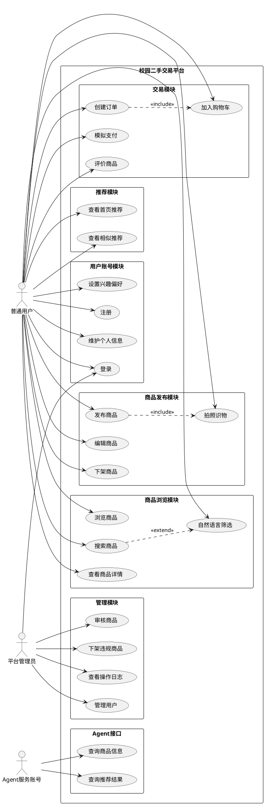
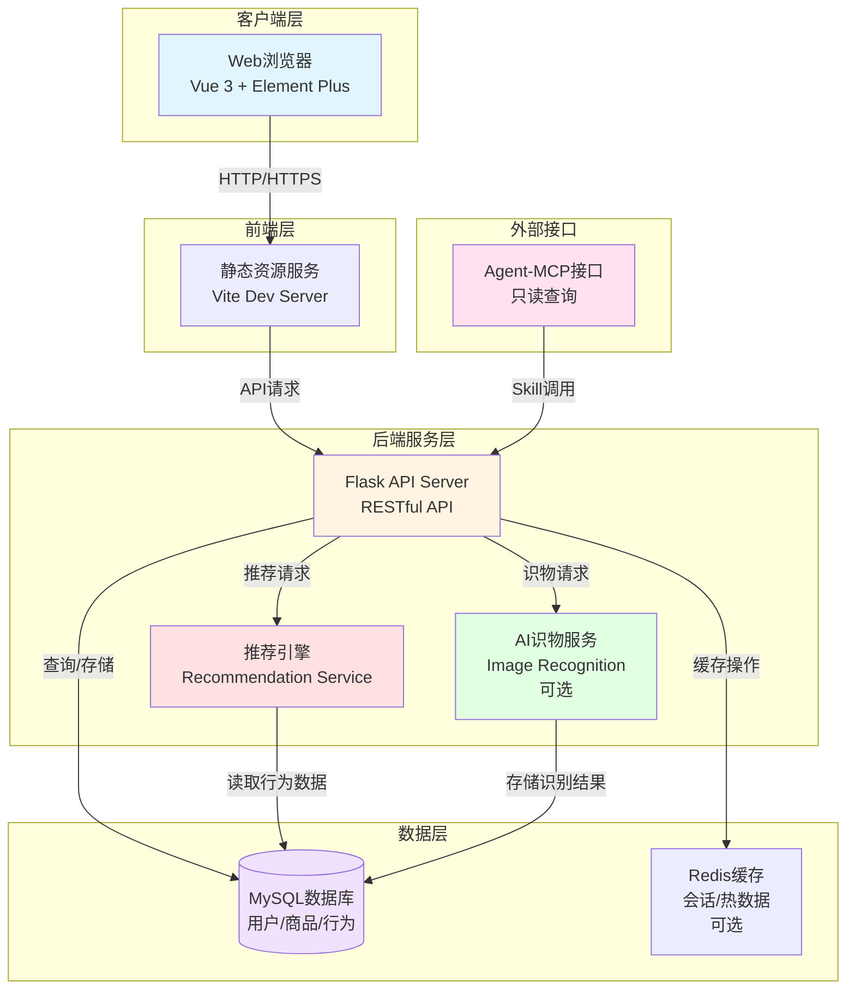
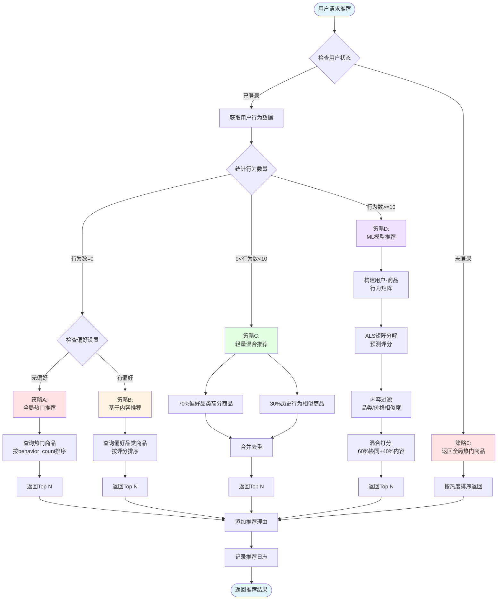
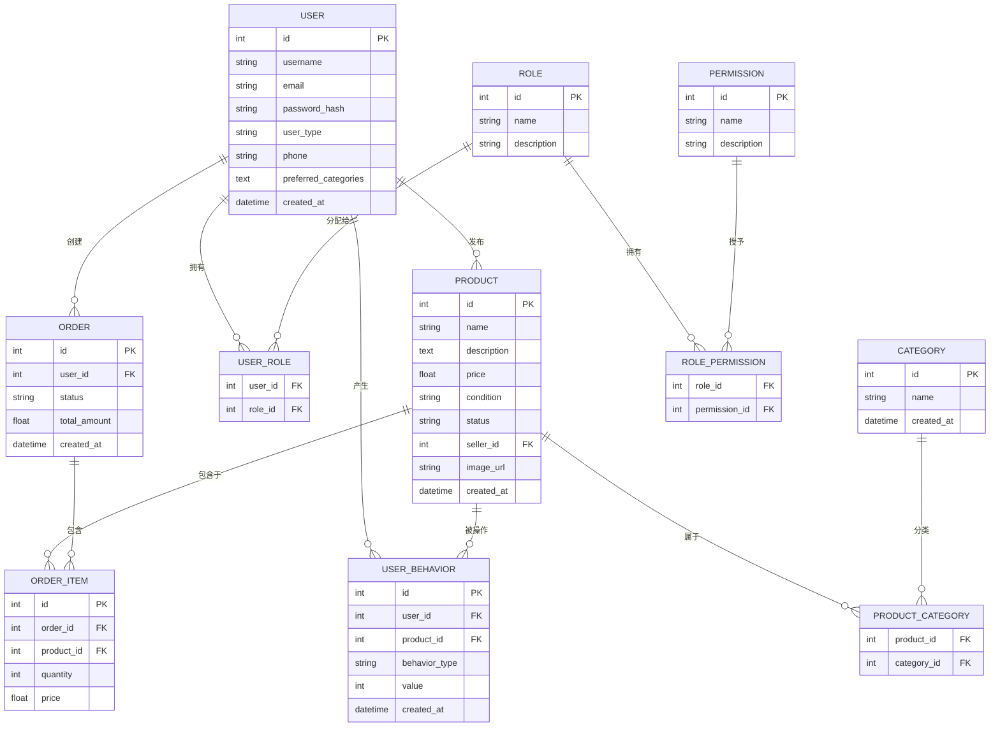
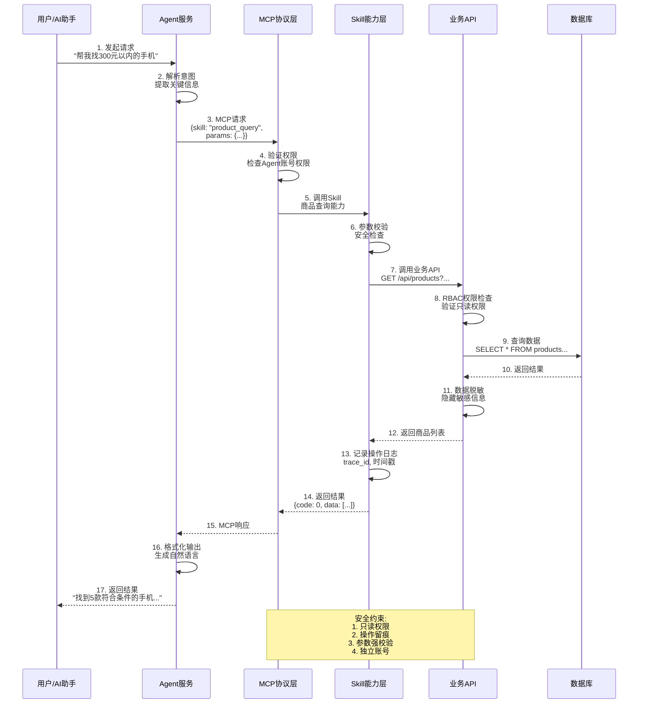

# 校园二手交易平台 - 需求文档图表

## 图1：用例图（Use Case Diagram）

### PlantUML代码（推荐）
复制到：https://www.planttext.com/ 或 https://plantuml.com/zh/



---

## 图2：系统架构图（System Architecture）

### Mermaid代码
复制到：https://mermaid.live/



---

## 图3：推荐算法流程图（Recommendation Algorithm Flow）

### Mermaid代码



---

## 图4：ER图（数据库关系图）

### Mermaid代码



---

## 图5：Agent-Skill-MCP交互流程图

### Mermaid代码



---

## 使用说明

### 方式1：在线渲染（推荐）

1. **PlantUML用例图**
   - 访问：https://www.planttext.com/
   - 复制上面的PlantUML代码
   - 点击"Generate"生成图片
   - 右键保存图片

2. **Mermaid图表**
   - 访问：https://mermaid.live/
   - 复制对应的Mermaid代码
   - 自动渲染
   - 点击右上角下载PNG/SVG

### 方式2：本地工具

1. **VS Code插件**
   - 安装 "PlantUML" 插件
   - 安装 "Markdown Preview Mermaid Support" 插件
   - 创建 `.puml` 或 `.md` 文件
   - 预览并导出

2. **命令行工具**
   ```bash
   # PlantUML
   java -jar plantuml.jar diagram.puml
   
   # Mermaid
   mmdc -i diagram.mmd -o diagram.png
   ```

### 方式3：在线美化工具

生成后可以用这些工具美化：
- **Figma** - 专业设计工具
- **Canva** - 快速美化
- **ProcessOn** - 在线绘图
- **Draw.io** - 免费开源

---

## 图片命名建议

保存时建议命名为：
- `01_用例图.png`
- `02_系统架构图.png`
- `03_推荐算法流程图.png`
- `04_ER图.png`
- `05_Agent交互流程图.png`

---

生成时间：2024
格式：PlantUML + Mermaid
用途：校园二手交易平台需求文档
