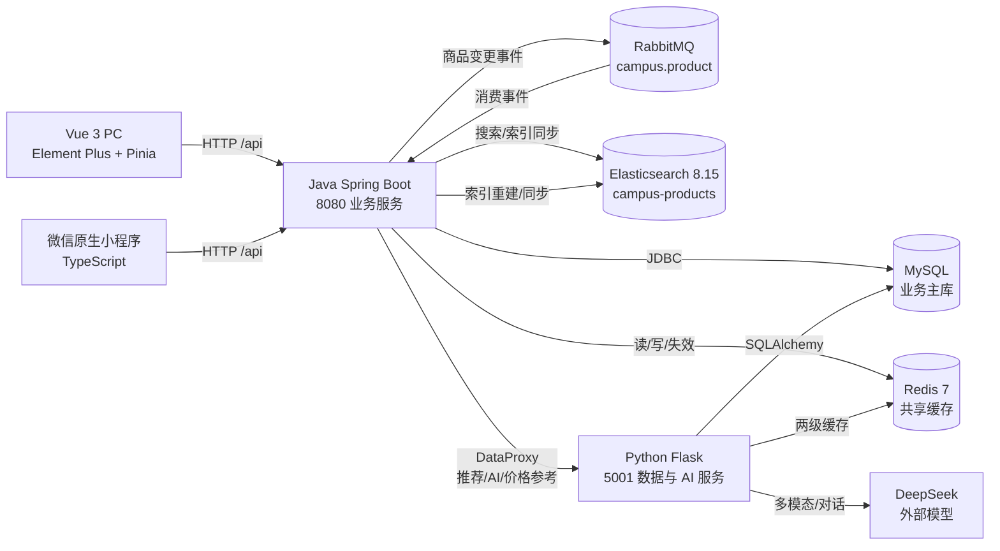
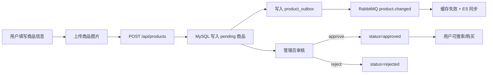
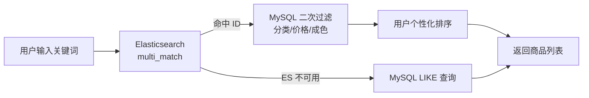
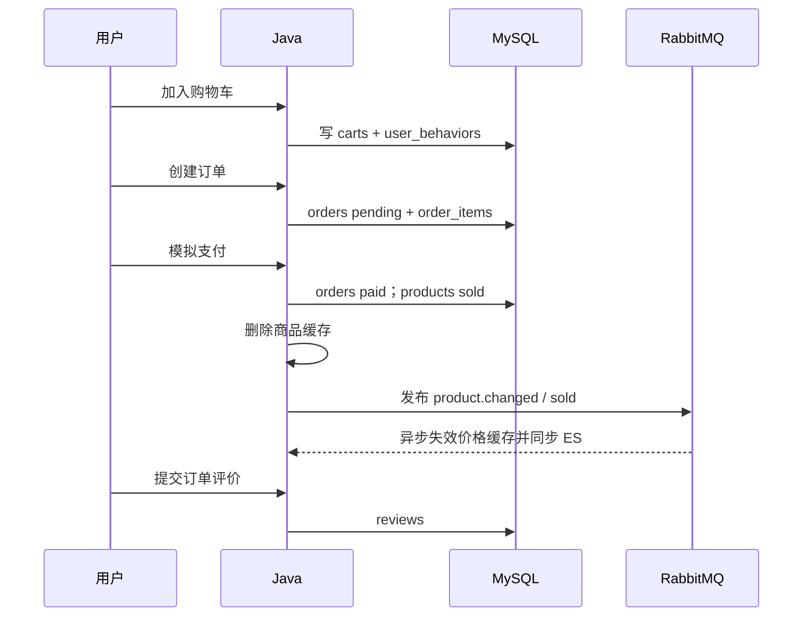
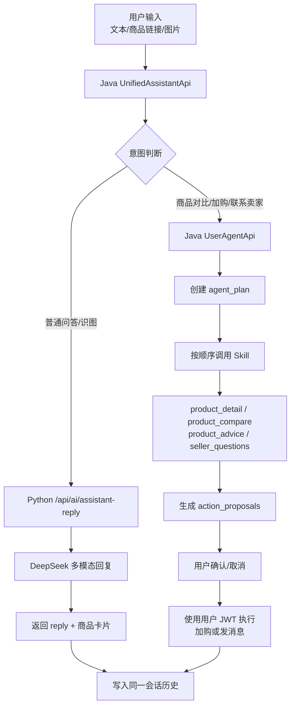
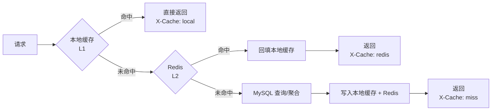
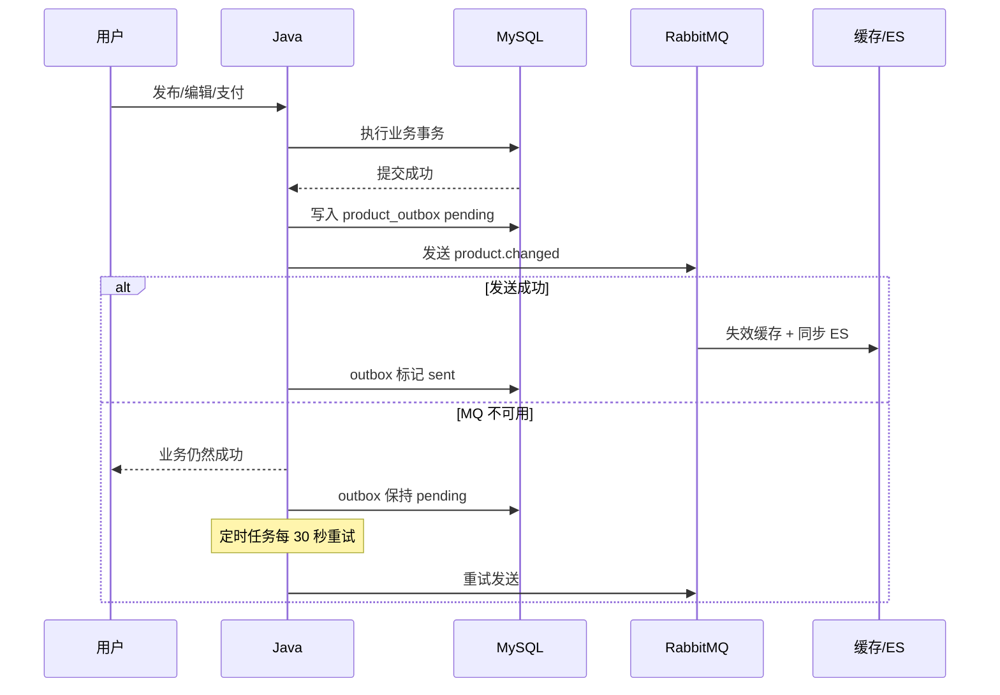
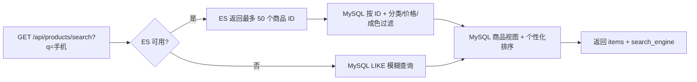
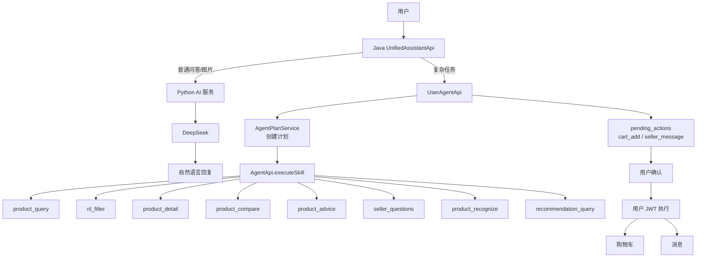

# 校园二手交易平台项目报告

- 报告日期：2026-11-11
- 项目名称：校园二手交易平台
- 代码仓库：`D:\aWusheng\SDproject`
- 当前分支：`feature-liubowen`
- 代码基线：`019efc8`
- 报告范围：PC Web、微信小程序、Java 业务服务、Python 数据服务、MySQL、Redis、RabbitMQ、Elasticsearch、Agent-Skill 平台

## 摘要

本项目面向校园二手交易场景，提供商品发布、审核、搜索、推荐、收藏、购物车、订单、评价、站内消息和 AI 购物助手等能力。系统采用 Vue 3 PC 前端和微信原生 TypeScript 小程序作为双端入口，Java Spring Boot 作为业务主服务，Python Flask 作为数据与 AI 服务，MySQL 作为业务数据主库，Redis、RabbitMQ、Elasticsearch 作为缓存、事件和搜索中间件。

系统设计的重点不是单纯完成 CRUD，而是处理三个问题：

1. **读多写少的商品目录如何降低数据库压力**：使用本地缓存 + Redis 两级缓存。
2. **商品状态变化后缓存和搜索索引如何同步**：使用 RabbitMQ 事件、outbox 补偿和幂等消费。
3. **AI 助手如何不只停留在“调用模型聊天”**：使用 Agent-Skill 注册中心、显式规划、工具调用、用户确认和权限边界。

当前实现已经完成核心交易闭环、推荐链路、Agent-Skill-MCP 平台化和小程序主要功能。微信开发者工具和浏览器完整人工点击链路已通过；手机真机交互、邮箱验证和找回密码仍属于后续验收工作。

---

## 一、项目目标与总体设计

### 1.1 业务目标

平台面向校园内的二手物品交易，主要角色包括：

| 角色 | 主要能力 |
|---|---|
| 普通用户 | 注册登录、浏览商品、搜索、收藏、发布商品、购物车、下单、支付、评价、消息、AI 助手 |
| 商品卖家 | 发布、编辑、下架、删除自己的商品，查看审核状态 |
| 管理员 | 用户管理、商品审核、下架、角色权限、Agent/Skill 管理、Agent 会话查看 |
| Agent 服务账号 | 通过 API Key/MCP 进行只读商品和推荐查询 |

### 1.2 设计原则

1. **MySQL 为业务事实源**：商品、订单、评价、用户关系以 MySQL 为准。
2. **缓存和索引是可重建的派生数据**：Redis 缓存和 Elasticsearch 索引都不承担最终一致性责任。
3. **写路径不被中间件阻塞**：商品写入成功后，缓存失效和搜索同步异步完成。
4. **AI 不直接操作核心数据**：模型输出只生成提议，业务动作由用户确认后通过用户 JWT 执行。
5. **PC 与小程序共享业务接口**：两端都通过 Java 8080 访问统一业务能力。

### 1.3 项目分工

| 成员 | 负责方向 | 主要职责 |
|---|---|---|
| 成员 A<br>09023225 刘博文 | RBAC · ADMIN · DATABASE | RBAC 五张表设计与初始化脚本；登录注册、BCrypt 加密、手机号脱敏；管理后台的用户管理、角色调整、审核、统计、操作日志；数据库表结构与迁移；微信小程序端实现 |
| 成员 B<br>09023420 赵璧莹 | PRODUCT · ORDER · FRONTEND | 商品发布、编辑、上架下架与状态机；订单流程、模拟支付、评价；卖家消息会话模块；两级缓存、RabbitMQ、ES 检索与降级；AI 识图功能实现、多轮购物助手 |
| 成员 C<br>09023217 王子会 | RECOMMEND · VISION · AGENT | 推荐四策略与用户行为表；识物接口与表单回填；同品类价格参考聚合；Agent-Skill-MCP 方案与需求、设计文档；PC 用户端页面与组件 |

---

## 二、系统架构

### 2.1 总体结构图



### 2.2 技术栈

| 层次 | 技术 |
|---|---|
| PC 前端 | Vue 3、Vite、Element Plus、Pinia、Vue Router、Axios |
| 小程序 | 微信原生小程序、TypeScript、WXSS、WXML、glass-easel |
| Java 业务服务 | Spring Boot 3.4.5、Spring JDBC、Spring AMQP、Jedis、Elasticsearch REST Client、JJWT、Spring Mail |
| Python 数据服务 | Flask 3.1.3、Flask-SQLAlchemy、Alembic、Flask-Limiter、PyJWT、Redis、Gunicorn |
| 数据库 | MySQL，开发实例 3407；Compose 使用 MySQL 8.4 |
| 缓存 | Redis 7，Java 本地缓存 + Redis 两级缓存 |
| 消息 | RabbitMQ 3.x，management 镜像，Exchange/Queue/Routing Key 显式声明 |
| 搜索 | Elasticsearch 8.15.5，CJK 分析器，`campus-products` 索引 |
| AI | DeepSeek 多模态模型，Python 数据服务代理，Java 负责会话和动作执行 |
| 邮件 | MailHog 开发环境；Spring Mail 生产配置 |
| 部署 | Docker Compose、Nginx 前端静态资源、Gunicorn Python 服务 |

### 2.3 工程结构

```text
SDproject/
├── frontend/                 Vue 3 PC 端
├── wx_client/                微信小程序
│   └── miniprogram/
│       ├── pages/            首页、搜索、详情、发布、订单、AI 助手等
│       └── utils/            API、认证、主题、请求封装
├── server/                   Java Spring Boot 业务服务
│   └── src/main/java/com/campus/market/
│       ├── CampusApi.java
│       ├── MiniProgramAuthApi.java
│       ├── CatalogCache.java
│       ├── ProductEventPublisher.java
│       ├── ProductCacheListener.java
│       ├── ProductSearchIndex.java
│       ├── UnifiedAssistantApi.java
│       ├── UserAgentApi.java
│       ├── AgentApi.java
│       ├── McpApi.java
│       └── SkillAdminApi.java
├── backend/                  Python 数据与 AI 服务
│   ├── routes/
│   ├── services/
│   ├── models.py
│   ├── migrations/
│   └── tests/
├── docs/                     中间件、Agent、复杂 Agent 文档
└── docker-compose.yml
```

---

## 三、业务流程

### 3.1 认证与权限流程

PC 端和小程序端使用不同的 token 交互方式，但底层都使用 JWT 和刷新会话：

1. 用户输入账号、密码和验证码。
2. Java 校验验证码、账号状态、密码和登录角色。
3. Java 生成 access token 和 refresh token。
4. PC 端 refresh token 通过 HttpOnly Cookie 保存；小程序通过响应体返回并保存到 `wx.setStorageSync`。
5. 访问业务接口时携带 `Authorization: Bearer <access_token>`。
6. access token 失效后，小程序通过 `/api/v1/auth/miniprogram/refresh` 轮换 refresh token。
7. 管理员和普通用户通过 RBAC 区分权限；Agent 服务账号不能通过小程序登录。

关键点：

- 验证码一次性使用，校验后立即移除。
- 登录失败有速率限制和失败计数。
- refresh token 轮换并只在服务端保存哈希。
- Agent API Key 与用户 JWT 是两套认证体系。

### 3.2 商品发布与审核流程



状态流转：

```text
pending -> approved -> sold
pending -> rejected
approved -> offline
pending / rejected / offline -> deleted
```

发布页支持：

- 商品名称、品牌、分类、成色、价格、描述、瑕疵说明、交易方式和交易地点。
- 商品图片上传。
- AI 识图填充：调用 `/api/ai/listing-recognize`，识别名称、品牌、分类和成色。
- 同品类成交价格参考：调用 `/api/products/price-reference`。

### 3.3 浏览、搜索与推荐流程

#### 浏览

- `/api/categories` 读取分类。
- `/api/products` 读取商品列表，支持分页、分类、关键词、成色和价格区间。
- `/api/products/{id}` 读取商品详情。
- 商品详情缓存只缓存公共商品信息，`is_favorited` 在缓存命中后单独按当前用户查询，避免把用户态写入公共缓存。

#### 搜索



搜索结果会返回 `search_engine=elasticsearch` 或 `search_engine=mysql`，便于观测是否发生降级。

#### 推荐

推荐分为四个阶段：

| 阶段 | 触发条件 | 策略 |
|---|---|---|
| A | 无兴趣偏好、无行为 | 全量热门 |
| B | 有兴趣偏好 | 兴趣分类匹配 |
| C | 有偏好且有少量行为 | 行为加权 |
| D | 行为数量较多 | ALS 矩阵分解 + 内容推荐 |

行为权重包括浏览、收藏、加购、下单和评价；推荐结果带 `recommendation_score` 和 `reason`，支持 offset 换一批。

### 3.4 交易流程



关键业务约束：

- 只能支付 `pending` 订单。
- 支付后商品变为 `sold`，从购物车移除。
- 取消 `pending` 订单后，商品恢复可购买状态并回到购物车。
- 评价与订单、商品、用户绑定。
- 交易核心表使用数据库事务保证订单状态和订单项一致。

### 3.5 站内消息流程

- 用户针对商品创建会话。
- 卖家/买家发送消息，消息写入 `conversation_messages`。
- AI 助手的 `seller_message` 动作只生成草稿，必须由用户确认后才真正打开会话并发送。
- 会话支持软删除，管理员可以查看异常会话。

### 3.6 AI 助手流程

AI 助手分为两条路径：



AI 助手的核心不是让模型直接访问数据库，而是：

```text
自然语言理解 -> 意图/规划 -> Skill 调用 -> 受控结果 -> 用户确认 -> 业务执行
```

### 3.7 管理后台流程

管理员可以：

- 查看用户、封禁/解封、调整角色。
- 审核商品、下架商品。
- 查看操作日志。
- 管理 Skill 草稿、发布、停用和测试。
- 创建 Agent API Key。
- 查看 Agent 会话和工单执行情况。

管理后台保留在 PC 端，不进入小程序，因为管理动作低频且需要复杂表格和批量操作。

---

## 四、中间件设计与验证

### 4.1 Redis 缓存

#### 4.1.1 工作原理

系统使用两级缓存：



核心实现：

- Java：`CatalogCache.java`
  - 本地缓存：`ConcurrentHashMap`
  - 远程缓存：`JedisPooled`
  - 默认本地 TTL 20 秒，Redis TTL 120 秒，本地最多 256 项
  - 统一前缀 `campus:cache:`
- Python：`services/cache_store.py`
  - 本地缓存：`OrderedDict` LRU
  - 远程缓存：Redis
  - 同样的两级读取和失效逻辑

读路径：

1. 先查本地缓存。
2. 本地未命中查 Redis。
3. Redis 未命中执行数据库 loader。
4. 将结果同时写回本地和 Redis。
5. 通过 `X-Cache: local|redis|miss` 暴露命中来源。

失效路径：

- 商品发布、编辑、下架、删除、支付后失效商品缓存。
- 商品所属分类的价格参考缓存同步失效。
- Redis 不可用时，本地缓存仍然工作；本地也没有时直接走数据库。

#### 4.1.2 使用在哪些业务

| 缓存 Key | 使用接口 | 缓存内容 |
|---|---|---|
| `categories` | `GET /api/categories` | 分类列表 |
| `product:{id}` | `GET /api/products/{id}` | 商品公共详情 |
| `price:{category}` | `GET /api/products/price-reference` | 同品类成交价参考 |

注意：商品详情中的 `is_favorited` 是用户私有状态，不放入公共缓存，而是在命中缓存后按当前用户查询。

#### 4.1.3 解决什么问题，为什么使用

使用前：

- 首页、详情页和发布页会频繁读取分类、商品和价格参考。
- 价格参考涉及订单、商品、分类的多表聚合，重复执行成本高。
- 商品详情是典型热点读接口。

使用后：

- 分类和商品详情避免重复访问 MySQL。
- 价格参考聚合结果可以短时间复用。
- 本地缓存提供最低延迟，Redis 提供跨 Java/Python 进程共享。
- 即使 Redis 故障，系统仍可依靠本地缓存和 MySQL 降级，不会直接不可用。

选择两级缓存而不是只用 Redis，是因为：

- 本地缓存没有网络往返，适合高频商品详情。
- Redis 解决多实例和跨服务共享。
- 使用较短 TTL 和事件失效，接受短时间最终一致。

#### 4.1.4 测试与结果

自动化测试文件：`backend/tests/test_cache.py`

覆盖内容：

1. 本地缓存 TTL 过期和 LRU 淘汰。
2. 本地 -> Redis -> miss 的两级读取顺序。
3. Redis 故障时仍能返回本地缓存。
4. 分类和价格参考的 `X-Cache` 从 `miss` 到 `local`。
5. 商品详情缓存不会污染用户收藏状态。
6. 本地缓存清空后可从 Redis 回填。
7. 支付后商品状态和价格参考缓存失效，重新从数据库读取。

实际测试结果：

```text
python -m pytest -q
82 passed
```

缓存测试覆盖了 `miss`、`local`、`redis` 三种状态，以及 Redis 故障降级和支付后的主动失效。

---

### 4.2 RabbitMQ 消息系统

#### 4.2.1 使用环节

商品状态发生变化时发布事件：

- 用户发布商品：`pending`
- 用户编辑商品：当前状态
- 用户下架/删除商品：`offline` / `deleted`
- 用户支付订单：`sold`
- 管理员审核通过/拒绝/下架

事件拓扑：

```text
Exchange:    campus.product
Queue:       campus.product.cache
Routing Key: product.changed
```

事件体：

```json
{
  "product_id": 9,
  "status": "sold",
  "event_id": "9:sold:1730000000000"
}
```

消费者 `ProductCacheListener` 负责：

1. 通过 `event_id` 做内存幂等去重。
2. 失效 `product:{id}`。
3. 失效该商品所属分类的 `price:{category}`。
4. 调用 `ProductSearchIndex.sync(productId)` 同步 Elasticsearch。
5. 对非 approved 商品执行索引删除。

#### 4.2.2 为什么用消息，而不是同步处理

如果商品写入后同步执行：

- 失效缓存
- 更新 ES
- 计算价格参考

会导致：

- 用户写请求被索引服务拖慢。
- ES 或缓存故障直接影响商品写入。
- 写路径和派生数据维护强耦合。

使用 RabbitMQ 后的取舍：

- **优点**：业务写入只依赖 MySQL 和 outbox，缓存与索引异步维护。
- **缺点**：存在短时间不一致窗口，需要重试和幂等。
- **适用边界**：商品展示、缓存和搜索可以接受秒级最终一致；订单支付等核心事务仍然同步落 MySQL。

#### 4.2.3 数据一致性解决方案

当前采用多层补偿：



一致性设计包括：

1. **MySQL 是事实源**：即使缓存和索引滞后，最终可以从 MySQL 重建。
2. **outbox 表**：`product_outbox` 保存 `event_id`、`payload_json`、`status`、`retry_count`、`next_retry_at`、`sent_at`。
3. **定时重试**：`@Scheduled(fixedDelay = 30000)` 扫描 pending 事件，最多每次 50 条。
4. **指数退避**：失败后 `next_retry_at = now + min(300, retry_count * 15)` 秒。
5. **消费幂等**：消费者按 `event_id` 去重；缓存失效和 ES 同步本身也是幂等操作。
6. **TTL 兜底**：即使事件丢失，缓存仍会在 120 秒内过期。
7. **ES 可重建**：启动时异步重建，并每 60 秒检查索引是否存在。
8. **ES 查询降级**：ES 不可用时退回 MySQL 查询。

需要明确的限制：

- 当前是**应用级 outbox**，业务写入和 outbox 登记不是同一个数据库事务，极端崩溃存在“商品已写、outbox 未写”的窗口。
- 消费端去重是进程内 Map，重启后丢失；由于失效和同步是幂等的，重复消费不会破坏数据。
- 严格生产级方案应改成同事务 outbox + CDC，或使用数据库事务消息表并由独立投递器保证投递。

#### 4.2.4 测试与结果

Java 单元测试 `ProductEventTest`：

- 重复 `event_id` 被忽略。
- RabbitMQ 发送失败时 `publish()` 不抛异常，业务写入不被破坏。
- ES 地址为空时搜索结果返回 `null`，调用方回退 MySQL。

手工链路验证记录见 `docs/middleware.md`：

- RabbitMQ 停止时修改商品：事件进入 outbox pending。
- RabbitMQ 恢复后：定时任务将 outbox 标记 sent。
- 商品修改后：商品缓存命中状态变为 `miss`。
- ES 文档版本从 3 增加到 4。
- 消费完成后队列 `messages=0, consumers=1`。

当前 Java 测试结果：

```text
Tests run: 14, Failures: 0, Errors: 0, Skipped: 0
```

---

### 4.3 Elasticsearch 站内搜索

#### 4.3.1 索引设计

索引名：`campus-products`

映射：

```text
name        text, cjk analyzer, boost 3
categories  text, cjk analyzer, boost 2
description text, cjk analyzer
status      keyword
```

查询：

```json
{
  "size": 50,
  "query": {
    "bool": {
      "must": [
        {
          "multi_match": {
            "query": "关键词",
            "fields": ["name^3", "categories^2", "description"]
          }
        }
      ],
      "filter": [
        { "term": { "status": "approved" } }
      ]
    }
  }
}
```

#### 4.3.2 搜索流程



#### 4.3.3 解决的问题与取舍

使用 ES 的原因：

- MySQL `LIKE %关键词%` 对中文多字段相关性排序能力弱。
- 商品名称、分类、描述需要不同权重。
- 搜索是高频只读接口，ES 能承担倒排索引和多字段匹配。

取舍：

- 额外维护一套索引数据，存在同步延迟。
- 索引不是事实源，ES 故障时必须能退回 MySQL。
- 只使用 ES 产生候选 ID，最终商品详情、价格、成色和权限过滤仍回 MySQL，避免索引文档成为业务事实。

#### 4.3.4 索引维护

- 应用启动时异步重建索引。
- 每 60 秒检查索引是否存在，缺失时自动重建。
- 商品事件触发 `sync(productId)`。
- 非 `approved` 商品从索引删除。
- ES 不可用时设置 15 秒冷却，避免短时间反复请求。

#### 4.3.5 测试与结果

自动化测试：

- `ProductEventTest.blankSearchAddressFallsBackToMysql` 验证 ES 地址为空时返回 `null`，调用方回退 MySQL。

手工验证（`docs/middleware.md`）：

```text
GET /api/products/search?q=手机
search_engine=elasticsearch

停止 Elasticsearch 后
search_engine=mysql

恢复 Elasticsearch 后
search_engine=elasticsearch
```

当前仓库没有独立的 ES 容器集成测试，ES 部分以实际接口验证和降级测试为主。

---

## 五、Agent-Skill 系统

### 5.1 为什么不能只调用模型

如果 AI 助手只做：

```text
用户输入 -> LLM -> 自然语言回复
```

会存在以下问题：

- 模型不知道真实库存、商品状态和价格。
- 模型可能编造商品。
- 模型直接生成 SQL 或执行写操作不可审计。
- 相同问题每次结果不稳定。
- 无法明确权限边界。

因此系统把 AI 能力拆成三层：

1. **自然语言理解**：由模型或规则完成。
2. **确定性业务能力**：由 Skill 执行，必须走 Java/Python 业务代码。
3. **动作执行**：只能生成 proposal，用户确认后才执行。

### 5.2 Agent 与 Skill 结构



### 5.3 Skill 清单

| 编号 | Code | 能力 | Scope |
|---|---|---|---|
| SK-001 | `product_query` | 商品列表/条件查询 | `product:view` |
| SK-002 | `nl_filter` | 自然语言筛选 | `product:view` |
| SK-003 | `recommendation_query` | 个性化推荐查询 | `recommendation:query` |
| SK-004 | `product_recognize` | 商品图片识别 | `product:view` |
| SK-005 | `product_detail` | 商品详情读取 | `product:view` |
| SK-006 | `product_compare` | 2-5 个商品对比 | `product:view` |
| SK-007 | `product_advice` | 商品购买建议 | `product:view` |
| SK-008 | `seller_questions` | 生成问卖家的问题 | `product:view` |

Skill 记录包含：

```text
code / name / module
input_schema_json
output_schema_json
allowed_operations
forbidden_operations
scope
handler_type
handler_target
status: draft / published / disabled
version
```

MCP 只暴露 `status='published'` 的 Skill，并通过 `readOnlyHint: true` 标明只读。

### 5.4 哪些功能加入了 Skill/Agent 思维链

这里的“思维链”不是暴露模型私有 chain-of-thought，而是**可审计的显式计划步骤**，即：

```text
plan_steps
-> 当前步骤
-> 调用了哪个 Skill
-> 生成哪些 action_proposals
-> 用户确认/取消
-> 最终状态
```

当前进入 Skill/规划链的业务包括：

1. **商品详情查询**
   - `product_detail`
   - 返回商品、评价、卖家信息。
2. **商品对比**
   - `product_compare`
   - 计算价格、成色分、性价比分和推荐理由。
3. **购买建议**
   - `product_advice`
   - 检查描述、瑕疵、交易方式等缺失信息。
4. **问卖家问题**
   - `seller_questions`
   - 生成联系卖家时的提问清单和话术。
5. **自然语言筛选**
   - `nl_filter`
   - 解析分类、价格、成色，转成结构化查询。
6. **商品图片识别**
   - `product_recognize`
   - 通过视觉模型提取商品关键词和图片信息。
7. **个性化推荐**
   - `recommendation_query`
   - 结合兴趣偏好、行为数据、ALS 和内容匹配。
8. **加购/联系卖家**
   - 先生成 `cart_add` 或 `seller_message` 动作提议，不直接执行。

### 5.5 多模态与多轮对话

#### 多模态

- 小程序发布页支持拍照/相册图片。
- `POST /api/ai/listing-recognize` 支持商品图片识别，填充名称、品牌、分类、成色和描述。
- Java 助手接口支持 `image_data_url` 和 `filename`。
- Python 通过 DeepSeek 多模态接口处理图片。
- 图片只用于识别和辅助，不直接把图片内容当作可执行指令。

#### 多轮对话

Java 统一保存：

- `conversation_sessions`
- `conversation_messages`
- `context_json`
- `slots`
- `product_ids`
- `active_plan_id`

Python 无状态接口接收：

- 最近 20 条历史消息
- 当前 slots
- 图片信息

这样支持：

- “上一款”
- “这个再便宜一点”
- “和刚才那款比较”
- “帮我加购”
- “取消刚才的操作”
- 继续确认 pending action

### 5.6 Agent 动作与安全措施

#### 权限边界

| 层级 | 措施 |
|---|---|
| 用户身份 | JWT access token / refresh token |
| Agent 外部身份 | API Key，只允许 `agent_service` 和 `admin` |
| API Key 存储 | SHA-256 hash + prefix，明文只显示一次 |
| API Key 生命周期 | scope、过期时间、最近使用时间、吊销 |
| MCP | 只暴露 published Skill，`readOnlyHint=true` |
| Skill 管理 | `skill:view` / `skill:manage` / `skill:test` |
| Skill 执行 | `scope` 校验 + handler 白名单 |
| 业务动作 | 只允许 `cart_add` 和 `seller_message` |
| 动作确认 | 用户 JWT 确认，Agent API Key 不能直接执行用户写操作 |
| 动作有效期 | pending action 默认 10 分钟 |
| 审计 | 操作日志、Agent 会话、Skill 发布/测试日志 |

#### 防 Prompt Injection

- 商品名、描述、评论等作为**数据**传给模型，不作为系统指令。
- 业务意图和可执行动作由 Java 规则/规划控制，不由模型自由决定。
- 商品通过 `product_id` 标识，不依赖模型输出 SQL。
- SQL 使用参数绑定，`InputSafetyTest` 验证搜索文本不会拼入 SQL。
- 禁止 AI 直接下单、支付、删除商品、修改价格。
- HTML 标签和输入长度有校验。
- Python 内部 AI 接口要求 `X-Internal-Token`，并使用 HMAC 比较。
- 写动作必须用户确认，动作过期后失效。

#### Agent 执行流程

```text
用户输入
-> 规则/模型理解
-> 创建 agent_plan
-> 调用 Skill 获取确定性数据
-> 生成 action_proposals
-> 写入 pending_actions
-> 前端展示确认/取消
-> 用户 JWT 确认
-> 执行业务动作
-> 更新 action 状态和 plan 状态
-> 写入操作日志
```

### 5.7 测试结果

Agent/API Key/Skill 相关自动化测试包括：

- `backend/tests/test_agent.py`
  - Agent API Key 只读。
  - 普通用户不能创建 API Key。
  - 无效 API Key 被拒绝。
  - API Key scope 被强制执行。
- `SkillAdminApiTest`
  - Skill 分页查询。
  - 创建 draft Skill 并审计。
- `InputSafetyTest`
  - SQL 参数绑定。
  - 验证码一次性使用。
  - NL 筛选和图片识别路由转发。
- `TokensTest`
  - HS256 JWT 兼容。
  - role/permission 声明。

---

## 六、验证摘要

### 6.1 自动化验证

| 测试层 | 命令/文件 | 结果 |
|---|---|---|
| Java 单元/接口测试 | `mvn test` | 14 passed |
| Python 数据与 AI 测试 | `python -m pytest -q` | 82 passed |
| 小程序 WXSS 编译 | `wcsc -lc` | 全部通过 |
| 小程序 WXML 编译 | `wcc -o NUL` | 全部通过 |
| 小程序 TypeScript | `tsc --noEmit` | 通过 |
| 前端构建 | `npm.cmd run build` | 通过（1534 modules，10.47s） |

### 6.2 中间件测试覆盖

| 中间件 | 自动化 | 手工验证 |
|---|---|---|
| Redis | 7 个缓存测试 | `X-Cache` 命中、Redis 故障、支付失效 |
| RabbitMQ | 幂等/发送失败/ES 降级单测 | 停止/恢复队列、outbox pending/sent、ES 版本递增 |
| Elasticsearch | ES 空地址降级测试 | ES 开/关时 `search_engine` 切换，索引重建 |
| Agent | API Key scope、Skill 管理、输入安全 | 开发者工具/接口联调 |

> 本节只保留项目级验证摘要。详细测试环境、测试用例、执行记录、性能测试、缺陷和遗留风险见单独提交的《测试报告》。

### 6.3 UI 与端到端验证

- 微信开发者工具：编译和页面运行通过
- 浏览器：注册、登录、浏览、详情、收藏、购物车、订单、模拟支付、评价链路通过
- 手机真机：未覆盖
- HTTPS/合法域名：未完成
- 1000 并发和长时间稳定性：未完成

---

## 七、关键设计取舍与改进方向

### 7.1 已做取舍

1. **Redis + 本地缓存**：以短 TTL 换取性能，接受秒级缓存不一致。
2. **RabbitMQ 异步派生数据**：不阻塞商品写入，接受事件延迟。
3. **ES 只做搜索候选**：相关性交给 ES，业务事实仍以 MySQL 为准。
4. **AI 只生成提议**：不直接写业务库，用户确认后使用用户 JWT 执行。
5. **Agent API Key 只读**：外部 Agent 不拥有用户写权限。
6. **PC 管理后台不进入小程序**：低频管理操作保留在 PC。

### 7.2 可改进方向

1. 将应用级 outbox 改为同事务 outbox 或 CDC，消除业务写入和事件登记之间的崩溃窗口。
2. 为 ES 增加专门的容器集成测试，覆盖索引重建、字段权重和降级。
3. 给 RabbitMQ 消费端增加持久化幂等表或 Redis 去重，避免重启后重复处理。
4. 为缓存增加命中率、回源率和 ES 降级率监控。
5. 对 Agent 动作确认增加操作幂等键和更完整的审计追踪。

---

## 八、结论

本项目已经形成完整的校园二手交易业务闭环，并在关键链路上引入了适合场景的中间件：

- **Redis** 解决高频商品目录读取和价格参考聚合的重复计算问题。
- **RabbitMQ** 将商品写入与缓存失效、ES 索引更新解耦，并通过 outbox 和幂等消费提升可靠性。
- **Elasticsearch** 提升中文多字段站内搜索能力，同时保留 MySQL 降级路径。
- **Agent-Skill** 将 AI 从“只会生成文本”提升为“受控地调用业务能力”，并通过 Key、scope、MCP、动作确认和审计实现安全边界。

当前系统的核心实现和自动化测试已经通过；严格 outbox 属于后续架构演进，完整测试环境、用例、执行证据和遗留风险见单独提交的《测试报告》。

---

## 附录 A 运行与演示

### A.1 端口

| 组件 | 端口 |
|---|---:|
| MySQL | 3407 |
| Redis 宿主机 / 容器 | 16379 / 6379 |
| RabbitMQ | 5672 |
| RabbitMQ 管理台 | 15672 |
| Elasticsearch | 9200 |
| Java 业务服务 | 8080 |
| Python 数据服务 | 5001 |
| 前端开发服务 | 5173 |

### A.2 启动顺序

```text
MySQL
-> Redis / RabbitMQ / Elasticsearch
-> Python 数据服务
-> Java 业务服务
-> Vue 前端
```

常用命令：

```powershell
# 根目录
powershell -ExecutionPolicy Bypass -File .\scripts\start-mysql.ps1
docker compose up -d redis rabbitmq elasticsearch

# Python
cd backend
python data_server.py

# Java
cd server
java -jar target\market-server-0.1.0.jar

# 前端
cd frontend
npm.cmd run dev
```

Redis 使用宿主机 `16379` 映射到容器内部 `6379`；本地 Python 和 Java 连接 `127.0.0.1:16379`。

## 附录 B 数据库核心表

| 领域 | 表 |
|---|---|
| 用户与权限 | `users`、`roles`、`permissions`、`user_roles`、`role_permissions` |
| 商品 | `products`、`categories`、`product_categories` |
| 交易 | `carts`、`orders`、`order_items`、`reviews` |
| 行为 | `user_behaviors`、`behavior_events` |
| Agent | `conversation_sessions`、`conversation_messages`、`agent_plans`、`pending_actions` |
| 中间件与能力 | `product_outbox`、`skills`、`api_keys` |

## 附录 C 演示路径

```text
登录/注册
-> 首页/搜索
-> 商品详情
-> 收藏
-> 购物车
-> 创建订单/模拟支付/取消/评价
-> 发布闲置/我的发布
-> AI 链接分析/对比/加购确认/卖家消息
-> 管理后台审核与日志
```
